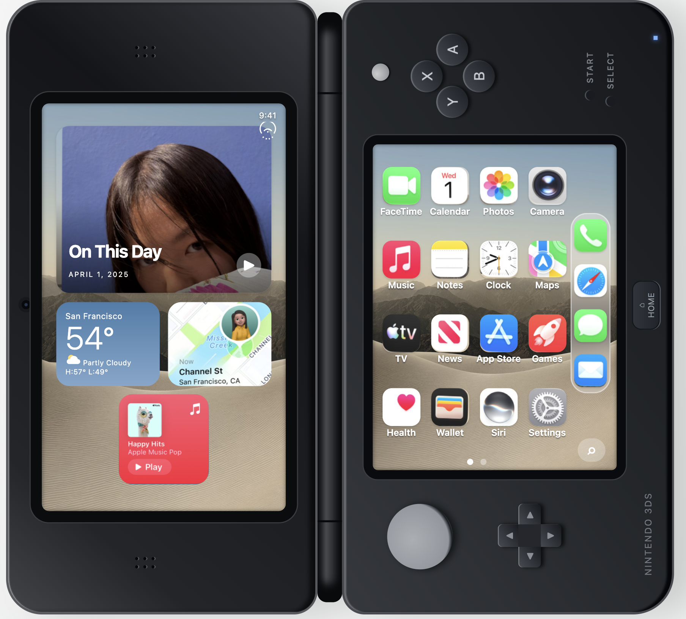
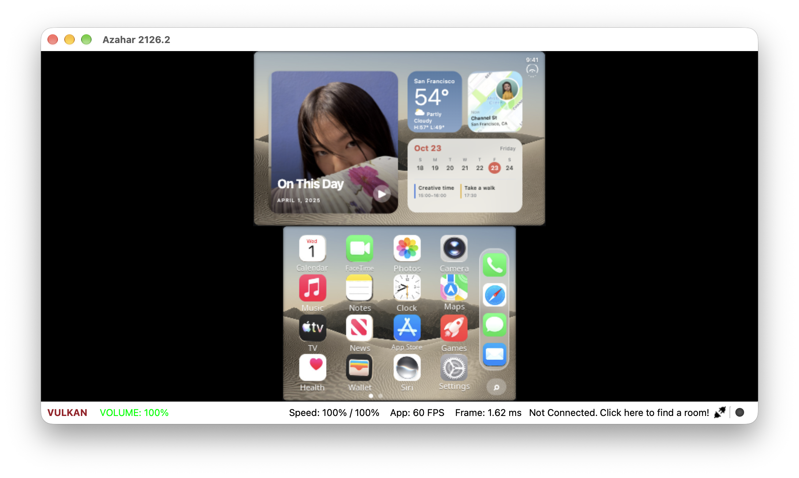

<div align="center">

# iPhone Duo for Nintendo 3DS

Native Nintendo 3DS homebrew recreating the iPhone Duo dual-screen home screen and cross-hinge interactions.

[English](README.md) | [简体中文](README.zh-CN.md) | [Build for 3DS](#build-for-3ds) | [Install on Your SD Card](#install-on-your-sd-card) | [Controls](#controls)

[](https://github.com/JosssphZhou/iphone-duo-3ds/actions)


[](LICENSE)

</div>

## Build for 3DS

Install the **devkitPro 3DS toolchain** (`devkitARM`, `libctru`, `citro2d`, `citro3d`, `3dstools`, and `tex3ds`) following the [official devkitPro setup guide](https://devkitpro.org/wiki/Getting_Started). You will also need Git, Python 3.9+, and `make`.

All prepared textures are committed to the repository, so you can build directly after cloning:

```sh
git clone https://github.com/JosssphZhou/iphone-duo-3ds.git
cd iphone-duo-3ds
python3 tools/check_assets.py
cd iphone-duo-3ds-native
./build.sh -j4
```

`iphone-duo-3ds-native/build.sh` outputs `iphone-duo.3dsx` and `iphone-duo.smdh` in `iphone-duo-3ds-native/`. By default, the build script looks for devkitPro at `/opt/devkitpro`; set `DEVKITPRO` and `DEVKITARM` if your toolchain is installed elsewhere.

## Install on Your SD Card

On a Nintendo 3DS with **Homebrew Launcher**, copy both build outputs to your SD card:

```text
SD:/
└── 3ds/
    └── iphone-duo/
        ├── iphone-duo.3dsx
        └── iphone-duo.smdh
```

All graphics are packed into `.3dsx` via RomFS—you do not need to copy `gfx/` or the browser prototype onto the SD card. When updating an existing installation, keep `layout.bin` and `language.bin` in that folder to preserve your icon arrangement and language preference.

Insert the SD card back into the console and launch **iPhone Duo** from Homebrew Launcher.

## Controls

| Input | Action |
| --- | --- |
| Touch an icon / D-pad then A | Open app preview |
| Hold an icon, then drag | Enter edit mode and rearrange icons |
| Drag Music toward the hinge | Expand the Music widget onto the upper display |
| Hold Music while widget is active | Open removal menu; release and tap to fold widget back |
| B / touch outside removal menu | Dismiss removal menu |
| B | Exit icon edit mode or return to home screen |
| L | Toggle landscape and book orientation (disables auto-rotation) |
| R | Toggle sensor debug overlay |
| X | Switch between day and night wallpapers |
| Y | Switch home screen pages |
| Hold SELECT, then press Y | Switch UI language (English / Chinese) |
| Press and release SELECT | Lock or wake screen |
| Swipe up from bottom of touchscreen | Unlock to home screen |
| START | Exit to Homebrew Launcher |

The hardware HOME button remains handled by the 3DS system menu. Use **L** for reliable orientation switching; accelerometer auto-rotation is experimental and still awaiting calibration on physical hardware.

## Features

- **Cross-hinge Music widget:** Long-press **Music** until the icons wiggle, then drag it across the hinge to expand an Apple Music widget on the upper screen. Long-press **Music** and tap **Remove widget** to fold it back into its current slot, even if you moved the icon to another spot or page.
- **Customizable home screen:** Rearrange icons across two home screen pages and the Dock in wiggle mode, with layout saved to the SD card.
- **Landscape and book orientations:** Press **L** to rotate the interface 90 degrees into book mode, placing the upper display on the left and the touchscreen on the right.
- **Lock screen, themes, and bilingual UI:** Swipe up to unlock, toggle day and night wallpapers, and switch labels and menus between English and Chinese at any time.

> **Note:** This project is an interface and interaction demo. It does not run iOS apps, play audio, place calls, or connect to the network.

## Project Structure

The native runtime renders at **400 × 240** on the upper screen and **320 × 240** on the lower touchscreen (**240 × 400** and **240 × 320** logically in book orientation, with matching touch coordinate transforms). Only the lower screen supports touch input on 3DS hardware.

Icons, labels, and backgrounds are pre-rendered at native 3DS resolutions and packed into RomFS texture atlases during the build.

```text
iphone-duo-3ds-native/       Native C runtime, texture atlases, interaction logic, tests
iphone-duo-3ds-prototype/    Interactive web prototype and reference assets
docs/images/                 Emulator and web prototype screenshots
tools/                       Asset verification, optional asset importer, host test runner
asset-manifest.json          SHA-256 manifest for all 945 bundled asset files
```

<details>
<summary><strong>Host tests and verification</strong></summary>

Host-side interaction and asset tests require Python 3.9+ and a C11 compiler (no 3DS toolchain required):

```sh
python3 tools/check_assets.py
bash tools/test_host.sh
python3 -m unittest discover -s tests -p '*_test.py' -v
```

Set `SANITIZE=1 bash tools/test_host.sh` to run the C test suite with AddressSanitizer and UndefinedBehaviorSanitizer.

</details>

<details>
<summary><strong>Asset manifest and raw regeneration</strong></summary>

`asset-manifest.json` tracks file sizes and SHA-256 checksums for all bundled textures and web assets. If local assets are modified, restore them with `git checkout` or re-import from a prepared directory:

```sh
python3 tools/import_assets.py \
  --native /path/to/prepared/iphone-duo-3ds-native \
  --web /path/to/prepared/iphone-duo-3ds-prototype
```

Pass `--replace` to overwrite existing files (a backup is created automatically). Rebuilding textures from raw source captures is only needed when modifying artwork; see [ASSET_INPUTS.md](iphone-duo-3ds-native/ASSET_INPUTS.md) for the asset pipeline.

</details>

## Status and Limitations

- **Emulator and hardware testing:** The current bilingual build has been verified in the Azahar emulator, and an earlier build was tested on a physical 3DS. Physical console verification for the latest bilingual updates and accelerometer rotation is still pending.
- **Static app previews:** Supported apps open static reference screens. Apps without a bundled preview stay on the home screen, and text baked into reference screenshots remains in its original language.
- **Experimental screens:** Archived Music and App Store interior mockups are excluded from the default navigation flow and are not fully localized.

## Browser Prototype and Screenshots

<details>
<summary>View web prototype details and screenshots</summary>

`iphone-duo-3ds-prototype/` contains a standalone browser prototype used to design and verify dual-screen layouts and animations. It is not needed to build or install the 3DS app. See [iphone-duo-3ds-prototype/README.md](iphone-duo-3ds-prototype/README.md) for usage details.



*Browser prototype in book orientation.*



*Native 3DS build running in the Azahar emulator.*

</details>

## Credits and License

Original project code is released under the [MIT License](LICENSE). Bundled Apple reference imagery, icons, screenshots, artwork, and third-party trademarks **are not covered by the MIT License** and remain the property of their respective owners. Noto Sans is distributed under the SIL Open Font License.

This is an independent fan project and is not affiliated with or endorsed by Apple or Nintendo. See [THIRD_PARTY.md](THIRD_PARTY.md) for full attribution and license details.
